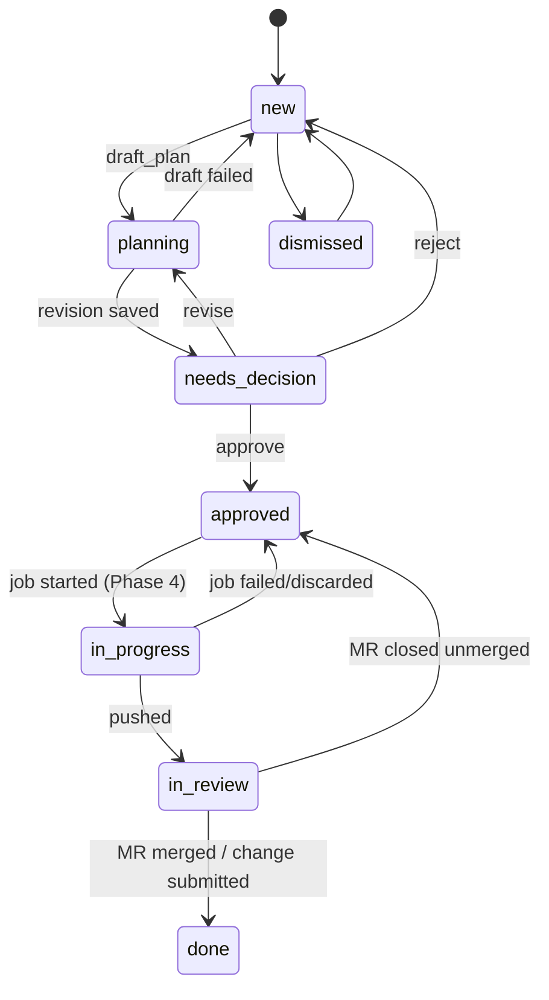

# 03 — Phase 3: Jira work items, planner and plan approval

Status: approved baseline, 2026-10-21. Depends on Phase 2 (Jira connector, agents, inbox).

Goal: each Jira ticket assigned to a user becomes a **work item** on a board. The user (or an opt-in intake schedule) asks the planner for a **plan**. The plan is structured data rendered by our UI, revised until the user approves an exact revision. An approved revision is the only input Phase 4 accepts.

## 1. Concepts

| Concept | Meaning |
|---|---|
| Work item | One Jira issue + one repository (project) for one user. Private to its owner. |
| Plan | The planning thread for a work item. Holds immutable revisions. |
| Plan revision | One complete `PlanDoc`. Never edited in place. Any change creates a new revision. |
| Approval | A decision row bound to `(subject, payload_hash)`. Shared by Phase 3 (plan approval) and Phase 4 (push approval). |

v1 limitation: one repository per work item. If a ticket needs two repos, the planner says so in `ambiguities`, and the user creates a second work item for the other repo.

## 2. Data model (migrations 0011–)

```sql
create table jira_issues (                -- per-user cache, refreshed by intake and on open
  id             bigint generated always as identity primary key,
  owner_id       int not null references users on delete cascade,
  integration_id int not null references integrations on delete cascade,
  key            text not null,
  summary        text not null,
  status         text not null,
  issue_type     text,
  priority       text,
  updated_remote timestamptz not null,
  fields         jsonb not null,           -- description, labels, components, links (no attachments)
  fetched_at     timestamptz not null default now(),
  unique (owner_id, integration_id, key)
);

create table work_items (
  id               uuid primary key default gen_random_uuid(),
  owner_id         int not null references users on delete cascade,
  jira_issue_id    bigint not null references jira_issues on delete cascade,
  project_id       int references projects on delete set null,
  state            text not null default 'new' check (state in
                     ('new','planning','needs_decision','approved','in_progress','in_review','done','dismissed')),
  current_plan_id  uuid,
  current_job_id   uuid,                   -- Phase 4
  created_at       timestamptz not null default now(),
  updated_at       timestamptz not null default now(),
  unique nulls not distinct (owner_id, jira_issue_id, project_id)
);

create table plans (
  id               uuid primary key default gen_random_uuid(),
  work_item_id     uuid not null references work_items on delete cascade,
  owner_id         int not null references users on delete cascade,
  status           text not null check (status in ('drafting','needs_decision','approved','rejected','superseded','failed')),
  current_revision int not null default 0,
  base_sha         text,                   -- repo commit the plan was made against
  base_branch      text,
  error            text,
  created_at       timestamptz not null default now(),
  updated_at       timestamptz not null default now()
);

create table plan_revisions (
  id            uuid primary key default gen_random_uuid(),
  plan_id       uuid not null references plans on delete cascade,
  revision      int not null,
  content       jsonb not null,            -- PlanDoc
  content_hash  char(64) not null,         -- sha256 of canonical JSON (sorted keys, no whitespace)
  author        text not null check (author in ('planner','user')),
  change_note   text,                      -- user's feedback or edit note
  validation    jsonb not null,            -- ValidationResult (§4)
  session_id    uuid references chat_sessions on delete set null,  -- planner transcript (source='run')
  cost_usd      numeric(12,6),
  created_at    timestamptz not null default now(),
  unique (plan_id, revision)
);

create table approvals (
  id           uuid primary key default gen_random_uuid(),
  owner_id     int not null references users on delete cascade,
  subject_type text not null check (subject_type in ('plan_revision','job_push')),
  subject_id   uuid not null,
  payload_hash char(64) not null,          -- what exactly was approved
  decision     text not null check (decision in ('approved','rejected','changes_requested')),
  comment      text,
  ip           text,
  decided_at   timestamptz not null default now()
);
create index approvals_subject on approvals (subject_type, subject_id);
```

`approvals` is append-only: a trigger raises on `UPDATE`; rows are removed only by the cascade when the owning user is deleted. A test asserts no code path issues `update(Approval)` or `delete(Approval)`.

`users` gains `jira_intake_enabled bool not null default false`, `jira_intake_jql text`, `jira_autoplan_label text` (§7).

## 3. PlanDoc schema

`app/plans/schema.py`, Pydantic, `extra="forbid"`. The planner's `output_type` is `PlanDoc`.

```python
class FileChange(BaseModel):
    path: str = Field(max_length=300)                     # repo-relative, normalised by validation
    action: Literal["create", "modify", "delete"]
    description: str = Field(max_length=1000)

class TestItem(BaseModel):
    name: str = Field(max_length=200)
    kind: Literal["unit", "integration", "e2e", "manual"]
    description: str = Field(max_length=1000)

class Alternative(BaseModel):
    name: str = Field(max_length=120)
    pros: list[str] = Field(max_length=6)
    cons: list[str] = Field(max_length=6)

class Ambiguity(BaseModel):
    question: str = Field(max_length=500)
    assumption: str = Field(max_length=500)               # what the plan assumes if unanswered

class Risk(BaseModel):
    risk: str = Field(max_length=500)
    mitigation: str = Field(max_length=500)

class SandboxRequest(BaseModel):
    optional_hosts: list[str] = Field(default=[], max_length=10)   # must be in admin's optional list (ADR-12)
    cpus: int = Field(default=2, ge=1, le=4)
    memory_gb: int = Field(default=4, ge=2, le=8)
    timeout_min: int = Field(default=45, ge=10, le=120)
    max_attempts: int = Field(default=3, ge=1, le=5)

class PlanDoc(BaseModel):
    schema_version: Literal[1] = 1
    title: str = Field(max_length=200)
    summary: str = Field(max_length=3000)                 # Markdown
    ambiguities: list[Ambiguity] = Field(max_length=20)
    knowledge_refs: list[int] = Field(max_length=20)      # document ids the planner relied on
    approach: str = Field(max_length=6000)                # Markdown
    alternatives: list[Alternative] = Field(max_length=4)
    changes: list[FileChange] = Field(min_length=1, max_length=60)
    tests: list[TestItem] = Field(max_length=40)
    verification: list[str] = Field(min_length=1, max_length=10)   # shell commands run in the sandbox (Phase 4)
    risks: list[Risk] = Field(max_length=15)
    rollback: str = Field(max_length=2000)
    estimate: Literal["S", "M", "L", "XL"]
    commit_message: str = Field(max_length=2000)          # first line ≤ 72 chars, must start with the Jira key
    sandbox: SandboxRequest = SandboxRequest()
```

## 4. Deterministic validation

`validate_plan(doc, project, base_sha) -> ValidationResult` runs after every revision, planner- or user-made. It never calls an LLM.

```python
class Issue(BaseModel):
    level: Literal["error", "warning"]
    field: str                 # JSON path, e.g. "changes[3].path"
    message: str

class ValidationResult(BaseModel):
    ok: bool                   # no errors
    issues: list[Issue]
    needs_ack: list[str]       # warnings the user must tick before approving
```

| Check | Level |
|---|---|
| Paths: relative, normalised, no `..`, no leading `/`, not under `.git/`, ≤ 300 chars | error |
| `modify`/`delete` paths exist at `base_sha`; `create` paths do not | error |
| Duplicate paths in `changes` | error |
| Paths under CI/CD config (`.gitlab-ci.yml`, `Jenkinsfile*`, `.github/`, `deploy/`, `helm/`, `k8s/`, `*.tf`) | warning + needs_ack |
| `commit_message` first line ≤ 72 chars and starts with the Jira key | error |
| `sandbox.optional_hosts` all in `MWB_SANDBOX_OPTIONAL_HOSTS` | error for unknown hosts; warning + needs_ack for each requested optional host |
| `verification` commands: each ≤ 500 chars; contains `curl`/`wget`/`ssh`/`scp`/`nc ` | warning (shown, no ack) |
| `knowledge_refs` visible to the owner (ACL) | invalid ids dropped with a warning |
| More than 30 files changed or estimate `XL` | warning + needs_ack ("large change; consider splitting") |

Approve is disabled unless `ok` and all `needs_ack` items are ticked. The acknowledgements are part of the approval payload (§6).

*Changed while building P2:*

- **`validate_plan(doc, *, jira_key, existing_paths, visible_refs, optional_hosts)` is pure.** The caller supplies the tracked paths at `base_sha` (`None` when the repository can't be read: existence isn't checked and a warning says so), the knowledge ids the owner can see (`visible_document_ids`, through `app.knowledge.acl`, R2), and `MWB_SANDBOX_OPTIONAL_HOSTS` (added now, read by Phase 4 too). It returns the cleaned document (paths normalised, e.g. `./a//b.py` → `a/b.py`; invisible refs dropped) and the result.
- **`needs_ack` keys are stable strings**: `ci_config:<path>`, `optional_host:<host>` (lower-case), `large_change`. Paths with backslashes or NUL are errors. Paths over 300 characters are already refused by the schema.
- **Approval payload:** `payload_hash = sha256(content_hash + "\n" + "\n".join(sorted(set(acknowledged))))`. `approvals` gains `acknowledged text[]`, so Phase 4 can recompute it; `app.plans.approvals.plan_revision_approved(revision)` checks the stored content against `content_hash`, takes the latest decision for the revision, and recomputes the payload hash.
- **The append-only trigger** refuses every `UPDATE`, and a `DELETE` unless it comes from the foreign-key cascade of a deleted user (`pg_trigger_depth() ≥ 2`). A test scans `app/` for `update(Approval)`/`delete(Approval)` and raw SQL equivalents. `plan_revisions.content_hash` has a `^[0-9a-f]{64}$` CHECK.
- Migration 0012 creates `plans`, `plan_revisions` and `approvals`, and adds the `work_items.current_plan_id → plans` foreign key.

## 5. Planner

Agent `planner` (system agent, model alias `planner`, `max_tier=read`, output `PlanDoc`). Tools:

| Tool | Behaviour |
|---|---|
| `jira_get_issue` | from Phase 2 (untrusted) |
| `search_knowledge`, `get_session` | from Phase 1 |
| `repo_tree(dir, depth ≤ 3)` | lists tracked files under `dir` at `base_sha` from the ingest cache (`git ls-tree`) |
| `repo_read(path, start_line, end_line)` | reads ≤ 400 lines at `base_sha` via `git show <sha>:<path>`; refuses binary and > 1 MB; untrusted |
| `repo_grep(pattern, path_glob)` | `git grep -n -I --max-count=50` at `base_sha`; pattern length ≤ 200; fixed-string by default; untrusted |

All repo tools act on the owner's ingest cache for `work_item.project_id` at the plan's `base_sha`, with the same path checks as `_read` (no symlinks, inside checkout). They never fetch from the network; the plan task refreshes the cache first.

Task `draft_plan(plan_id, feedback: str | None)`, queue `llm`, `lock=f"plan:{plan_id}"`:

1. Short tx: load plan, work item, issue, project; set plan `drafting`, work item `planning`. Commit.
2. No tx: refresh Jira issue (connector), `git fetch` the project cache, resolve `base_branch` (project branch or remote HEAD) and `base_sha`.
3. No tx: run the planner. Input: issue fields (untrusted envelope), project card (owner's), the user's `how-i-work` page, previous revision JSON and the user's feedback when revising. Usage limits per 01 §H12 (`plan draft`).
4. No tx: `validate_plan`. If errors exist, run the planner once more with the issues list as feedback ("fix these validation errors"). Keep the second result even if still invalid; the user sees the errors.
5. Short tx: insert revision `current_revision + 1` with hash and validation; plan `needs_decision`; work item `needs_decision`; inbox item "Plan ready for PROJ-123". Commit.
6. On failure: plan `failed` with error; work item back to `new`; inbox item.

*Changed while building P3:*

- **The task lock is per repository**, `lock=f"project:{project_id}"`, because the plan task fetches and reads the shared ingest cache; `queueing_lock=f"plan:{plan_id}"` only de-duplicates queued work (R4). `draft_plan` returns without doing anything unless the plan is still `drafting`.
- **Step 1 moved into the request.** `POST /api/work-items/{id}/plans` (202) does step 1 in its own transaction: it needs a repository (`409`, `field: project_id`) and a work item in `new` or `needs_decision` (else `409`), supersedes the item's `needs_decision`, `failed` or `rejected` plans, creates a `drafting` plan and sets the work item `planning` with `current_plan_id`. `GET /api/plans/{id}` returns the plan with its current revision. Both are owner-only (404 otherwise) and were brought forward from P4 so the task can be started and observed; P4 adds approve/reject/revise.
- **Repo tool refusals** are tool errors the model sees: `invalid_args` (outside the checkout, `..`, absolute, `.git/`, a directory, a submodule, a binary file, a bad glob or pattern), `forbidden` (a symlink, never followed), `too_large` (> 1 MB), `not_found`. `repo_grep` takes `regex: bool` (basic regex; fixed string by default). Output is capped at 500 tree entries and 200 grep lines.
- **Validation inputs**: `existing_paths` is `git ls-tree -r` at `base_sha`. The fix attempt's prompt lists the errors; the second result is stored even if still invalid, and its inbox item is a warning saying so.
- **Failure** sets the plan `failed` with the error and the work item back to `new`, except when the plan already has a revision (a failed revise, P4): then plan and work item go back to `needs_decision` with the error kept, so the last good revision can still be decided on; the inbox item is "Planning PROJ-123 failed". Inbox items gain kind `plan` (link `/work/{id}/plan`).
- Migration 0013 adds `plans.auto` (auto-drafted, for the daily limit) and recreates the `inbox_items.kind` CHECK. The planner seed has `report: false`; agent evals cover report agents only.

## 6. Approval

`POST /api/plans/{id}/approve` body `{"revision": n, "content_hash": "...", "acknowledged": ["..."]}`:

- 409 `conflict` unless `revision == current_revision`, the stored hash equals `content_hash`, and plan status is `needs_decision`.
- 422 unless validation `ok` and `acknowledged` ⊇ `needs_ack`.
- In one transaction: insert `approvals(subject_type='plan_revision', subject_id=<revision id>, payload_hash=sha256(content_hash + sorted acknowledged), decision='approved')`; plan `approved`; work item `approved`; audit `plan.approve`.
- Phase 4 accepts a revision only if such an approval exists and its `payload_hash` recomputes correctly.

`POST /api/plans/{id}/reject` records `decision='rejected'`, plan `rejected`, work item `new`.

**User edits.** `POST /api/plans/{id}/revisions` with a full `PlanDoc` and `change_note` creates a user revision (validated the same way). The UI edits a copy of the current revision field by field; saving posts the whole document. A previous approval never carries over to a new revision.

**Revise with feedback.** `POST /api/plans/{id}/revise {"feedback": "..."}` (≤ 4000 chars) defers `draft_plan` with feedback.

## 7. Intake

Not an LLM run. Periodic `jira_intake_tick` (every 30 minutes, queue `default`) defers `jira_intake(user_id)` with `lock=f"intake:{user_id}"` for each active user who enabled intake in Settings (`users.jira_intake_jql`, default `assignee = currentUser() AND resolution = Unresolved`; `users.jira_intake_enabled`, default false). Each run:

1. Run the JQL (max 100 issues, updated in the last 30 days).
2. Upsert `jira_issues`.
3. For issues with no work item, create one in state `new`. `project_id` is guessed by matching Jira component or label to project names (exact, case-insensitive) or left null for the user to choose.
4. Optional auto-draft (`users.jira_autoplan_label`, e.g. `mwb-plan`): issues with that label and a project get `draft_plan` deferred, at most `MWB_AUTOPLAN_PER_DAY` (default 5) per user per day.

Issues that leave the JQL result are not deleted; their work items show the latest Jira status and can be dismissed.

*Changed while building P1:*

- **Migration numbering:** Phase 2 used 0006–0010, so `jira_issues`, `work_items` and the users' intake columns are migration 0011; `plans`, `plan_revisions` and `approvals` follow with P2. `work_items.current_plan_id` is a plain UUID until `plans` exists.
- **Intake runs per Jira integration** the user has credentials for (`jira_issues.integration_id`); a failing integration (401, outage) is logged and skipped, the others still run. Issues are fetched with `startAt` paging, 50 at a time, up to 100, with `(<jql>) AND updated >= -30d ORDER BY updated DESC`. `fields` stores description (ADF flattened), labels, components, links and assignee.
- **Repository guess:** exact, case-insensitive match of a component or label against the names of repositories the user can see (their own and the team's), used only when exactly one matches.
- **Auto-draft (step 4) arrives with the planner in P3**, since it defers `draft_plan`; `MWB_AUTOPLAN_PER_DAY` and its acceptance test move there.
- **API details:** `POST /api/work-items` takes an optional `integration_id` (required when the user has several Jira integrations); a duplicate is `409 conflict` with the existing `work_item_id`; an unknown issue is 404. `GET /api/work-items` hides dismissed items unless `state=dismissed` is asked for, and `state` may repeat. `PATCH` changes the repository only while the item is `new` or `dismissed`, and allows only `new ↔ dismissed` state changes. `GET /api/work-items/{id}` returns the cached description, links and assignee. Intake settings are on `PATCH /api/auth/me` (the API table's `PATCH /api/me`).

## 8. API

| Method and path | Purpose |
|---|---|
| `GET /api/work-items?state=&cursor=` | Board data (owner only) |
| `POST /api/work-items` `{jira_key, project_id}` | Create manually (fetches the issue) |
| `PATCH /api/work-items/{id}` `{project_id, state: 'dismissed'|'new'}` | Assign repo, dismiss, restore |
| `POST /api/work-items/{id}/plans` | Start a plan (defers `draft_plan`) |
| `GET /api/plans/{id}` | Plan with current revision, validation, approvals |
| `GET /api/plans/{id}/revisions` · `GET /api/plans/{id}/revisions/{n}` | History |
| `GET /api/plans/{id}/diff?from=&to=` | Field-level diff between revisions (server-computed) |
| `POST /api/plans/{id}/revise` · `POST /api/plans/{id}/revisions` | Planner revision / user revision |
| `POST /api/plans/{id}/approve` · `POST /api/plans/{id}/reject` | Decision |
| `PATCH /api/me` | adds `jira_intake_enabled`, `jira_intake_jql`, `jira_autoplan_label` |

## 9. Frontend

Layouts, navigation and flows are specified in [07-ux.md](07-ux.md) (§4.9, §4.10, §5.8). The plan page is the Plan tab of the work item hub (`/work/:id/plan`); `/plans/:id` remains a valid deep link. "Discuss" uses the chat context mechanism from 02 §6 with a `plan_revision` ref.

- **Board** (`/work`): columns New · Planning · Needs decision · Approved · In progress · In review · Done. Cards show key, summary, Jira status, project, cost so far. Drag is not supported; state changes come from actions.
- **Plan page** (`/plans/:id`): header (ticket, repo, base branch@sha, revision selector, status); sections rendered from `PlanDoc` with our components (Markdown fields use the safe renderer); validation panel with errors and acknowledgement checkboxes; "Revise with feedback" box; "Edit" mode; "Approve revision N" button showing the content hash prefix; revision diff view.
- **Discuss**: "Open in chat" creates a chat session with the plan's project in focus and the current revision attached as context (read-only).

## 10. State machines

Work item:



Plan: `drafting → needs_decision → (approved | rejected | drafting)`; `drafting → failed`; starting a new plan for the same work item marks the old one `superseded`.

## 11. Out of scope

Writing back to Jira from the planner (comments or transitions happen only at the Phase 4 push gate), multi-repo plans, plan templates per team.
