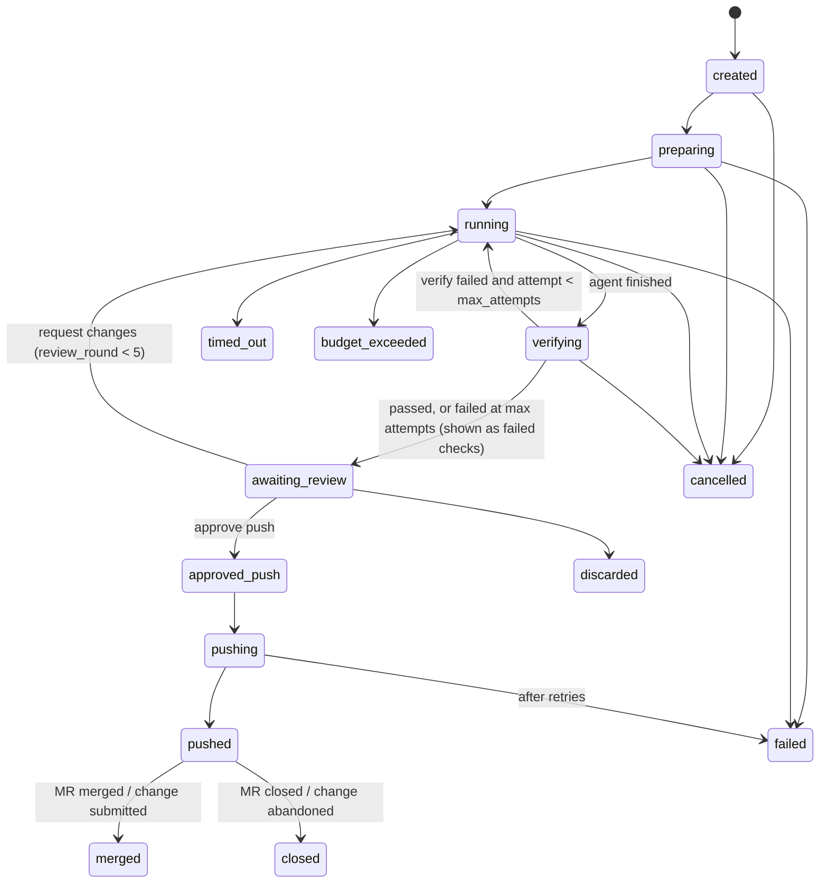

# 04 — Phase 4: sandboxed coding jobs and the push gate

Status: approved baseline, 2026-10-21. Depends on Phase 3 (approved plan revisions, `approvals`).

Goal: an approved plan revision becomes a **job**. Claude Code runs headless inside a locked-down container, our verifier checks the result independently, the user reviews the diff, and only after a second approval does the orchestrator push a branch and open a GitLab merge request or Gerrit change.

Design invariants:

1. The sandbox never holds git, Jira, Kubernetes, AWS or MyWorkBuddy credentials. Its only secret is a per-job LLM key with a small budget and short expiry.
2. The sandbox reaches only the egress proxy, which allows only the LLM gateway and package mirrors.
3. Only `runner` can start containers, and it accepts only fixed presets, never caller-supplied images, mounts or flags.
4. Nothing leaves MyWorkBuddy (push, MR, Jira comment) without an approval bound to the exact patch and messages (rule R5).

## 1. Components

| Component | Description |
|---|---|
| `worker-jobs` | Procrastinate worker on queue `jobs` (concurrency `MWB_MAX_CONCURRENT_JOBS`, default 2). Orchestrates jobs; holds user tokens for clone and push; talks to `runner`. |
| `runner` | Small FastAPI service (`runner/` package, own image). Only service with the Docker socket. Internal API with bearer `MWB_RUNNER_TOKEN`. Listens only on the `app` network. |
| `egress-proxy` | Squid. Two listeners: `3128` profile **agent** (gateway + mirrors) and `3129` profile **verify** (mirrors only). CONNECT/HTTP allowed only to `dstdomain` in the profile's list. No TLS interception. Access log kept 30 days. |
| `mwb-sandbox` image | Debian slim, non-root user `agent` (uid 1000), `git`, Python 3.12 + `uv`, Node 22 + npm, Go (pinned), common build tools, and Claude Code CLI pinned to an exact version. Built in CI, pinned by digest in runner config. No credentials, no SSH client config. |
| Container runtime | gVisor (`runsc`) is required when the host supports it (`MWB_SANDBOX_RUNTIME=runsc`); `runc` only with an explicit `MWB_SANDBOX_RUNTIME=runc` and a warning on the System page. |

Default allowlists (`MWB_PROXY_AGENT_HOSTS`, `MWB_PROXY_VERIFY_HOSTS`), editable by admins in config, not in the UI:

- agent: `llm-gateway` (port 4000), `pypi.org`, `files.pythonhosted.org`, `registry.npmjs.org`, `proxy.golang.org`, `sum.golang.org`, plus company mirrors (e.g. Nexus) if configured.
- verify: the same minus `llm-gateway`.
- optional (plan may request, ADR-12): `MWB_SANDBOX_OPTIONAL_HOSTS`, e.g. `github.com` for public dependencies.

Per-job optional hosts are applied by giving that job its own Squid ACL. The runner assigns each sandbox a fixed address from the `sandbox` subnet (`--ip`, allocated from a pool it tracks), writes `/etc/squid/jobs/<job_id>.conf` (`acl job_<id> src <that ip>` + allowed domains), reloads Squid (`squid -k reconfigure`), then starts the container, and removes the file when the run ends. The runner and the proxy share the `/etc/squid/jobs` volume (`squid.conf` has `include /etc/squid/jobs/*.conf`); the runner triggers the reload with `docker exec <proxy container> squid -k reconfigure`, which it can do because it already holds the Docker socket.

*Changed while building X1:*

- **Claude Code 2.1.293** is pinned in `sandbox/Dockerfile`. Its docs confirm the preset's flags: `-p` with `--output-format stream-json` (which needs `--verbose`), `--max-turns`, `--permission-mode bypassPermissions` (refused for root, so the uid-1000 user matters). `ANTHROPIC_DEFAULT_HAIKU_MODEL` replaces the deprecated `ANTHROPIC_SMALL_FAST_MODEL`, and `CLAUDE_CODE_DISABLE_NONESSENTIAL_TRAFFIC` also stops auto-updates (`DISABLE_AUTOUPDATER` stays as a belt). Unknown model names such as `coder` only print a warning. Run against the fake gateway, the CLI streams `POST /v1/messages?beta=true` through `HTTP_PROXY`, ends with a `{"type":"result"}` line (`is_error`, `total_cost_usd`), and does not retry an HTTP 400. That is how a LiteLLM budget error ("Budget has been exceeded") ends a run.
- **The turn cap is `AGENT_MAX_TURNS`**, not `MWB_MAX_TURNS`, so security test 3 can require that no `MWB_` variable reaches the sandbox. `ANTHROPIC_BASE_URL` is fixed by the runner (`http://llm-gateway:4000`) rather than allowlisted. The allowlist is `ANTHROPIC_AUTH_TOKEN`, `ANTHROPIC_MODEL`, `ANTHROPIC_DEFAULT_HAIKU_MODEL`, `AGENT_MAX_TURNS`, with values checked (printable, model-name pattern, 1–500 turns). The fixed proxy variables are set in both cases (`HTTPS_PROXY`/`https_proxy`, ...).
- **Name resolution.** `--dns 127.0.0.1` leaves the sandbox without an upstream resolver; `--add-host egress-proxy:<.2>` names the proxy. On the internal `mwb-sandbox` network (`MWB_SANDBOX_PREFIX`, default `172.31.0`, proxy at `.2`) Docker's embedded DNS still resolves members of that network, but nothing else.
- **The proxy** is Squid from Debian (`deploy/squid`), its config rendered at start from `MWB_PROXY_AGENT_HOSTS` / `MWB_PROXY_VERIFY_HOSTS` (the verify list may not contain `llm-gateway`). Ports: 80, 443 and 4000 only; CONNECT only to 443. `include /etc/squid/jobs/*.conf` comes before the general rules, so a job file (`acl job_<id> src <ip>` + its hosts + `http_access allow agent_port job_<id> ...`) widens only that sandbox. Access logs rotate daily, 30 kept.
- The gateway gains the `coder` model (`MWB_CODER_MODEL_ID`, default the chat model), which must be a Claude model because Claude Code uses LiteLLM's Anthropic route.
- **Tests.** The sandbox security tests run with runc in the CI job `sandbox`. They cover tests 1–3, plus uid, read-only root, empty capabilities and the agent smoke run, against the fake gateway's `POST /v1/messages` (`backend/tests/fakellm/anthropic.py`). The tests create containers with the runner's own `container_config`; probes replace only the command.
- **Known limit.** Sandboxes share one network, so two concurrent sandboxes can reach each other (nothing listens by default, and neither holds more than its own job key). A network per job is a Phase 5 candidate.

## 2. Data model (migration 0007)

```sql
create table jobs (
  id                uuid primary key default gen_random_uuid(),
  owner_id          int not null references users on delete cascade,
  work_item_id      uuid not null references work_items on delete cascade,
  plan_revision_id  uuid not null references plan_revisions,
  plan_approval_id  uuid not null references approvals,
  project_id        int references projects on delete set null,  -- deleting a project with an active job → 409
  base_branch       text not null,
  base_sha          text not null,
  branch_name       text not null,                -- mwb/<KEY>-<slug>, ≤ 100 chars
  status            text not null check (status in (
                      'created','preparing','running','verifying','awaiting_review',
                      'approved_push','pushing','pushed','merged','closed',
                      'failed','timed_out','budget_exceeded','cancelled','discarded')),
  failed_stage      text,
  attempt           int not null default 0,       -- agent attempts in the current review round
  review_round      int not null default 0,       -- user "request changes" rounds, max 5
  policy            jsonb not null,               -- frozen SandboxRequest + resolved allowlist + limits
  gateway_key_alias text,                         -- LiteLLM key alias (never the key)
  result            jsonb,                        -- JobResult (§5.4)
  push              jsonb,                        -- PushState (§6)
  cost_usd          numeric(12,6) not null default 0,
  error_code        text, error text,
  created_at        timestamptz not null default now(),
  started_at        timestamptz, finished_at timestamptz,
  updated_at        timestamptz not null default now()
);
create unique index one_active_job_per_item on jobs (work_item_id)
  where status in ('created','preparing','running','verifying','awaiting_review','approved_push','pushing');

create table job_secrets (               -- the per-job LLM key; deleted when the job leaves an active state
  job_id     uuid primary key references jobs on delete cascade,
  ciphertext text not null,              -- MultiFernet
  created_at timestamptz not null default now()
);

create table job_events (
  job_id  uuid not null references jobs on delete cascade,
  seq     int not null,
  at      timestamptz not null default now(),
  type    text not null,          -- status, agent_text, agent_tool, verify_cmd, check, push, error
  data    jsonb not null,
  primary key (job_id, seq)
);
```

Artifacts (existing `artifacts` table, gains `job_id uuid` and `sha256 char(64)`): agent transcript (stream-json), patch, verify logs, check report. Stored under `/data/artifacts/<owner_id>/<job_id>/`. Download endpoint enforces ownership.

## 3. State machine



Every transition: short transaction that checks the expected current status (`UPDATE jobs SET status=:new WHERE id=:id AND status=:expected`), appends a `job_events` row, and audits. A transition that finds an unexpected status aborts the step without side effects.

A job that ends in `awaiting_review` after failing verification at max attempts is allowed to be pushed only after the user ticks "Push despite failing checks" (part of the approval payload).

*Changed while building X3:*

- **Migration 0014**, not 0007 (Phases 2–3 used 0007–0013). `artifacts.job_id` cascades with the job. Inbox items gain kind `job`. CHECKs cover `jobs.status`, `job_events.type`, `branch_name` length ≤ 100 and `review_round` 0–5.
- **Three more transitions to `failed`**, each for a step that can break before the next status exists: `created → failed` (the LLM key can't be created), `verifying → failed` (the verify run or the patch can't be fetched) and `approved_push → failed` (the push task finds the approval doesn't match before it starts). That makes 25 transitions in `app/jobs/state.TRANSITIONS`.
- **Transitions** lock the job row, check that the status is one the caller expected, update it, append a `status` event (`{"from", "to", ...detail}`) and audit `job.<status>`, all in one transaction. `started_at` is set on the first `preparing`, `finished_at` on reaching a terminal status. Another status → `None` and no side effects. A pair the machine doesn't have raises `InvalidTransition`.
- **The work item follows its job:** `preparing`/`running` → `in_progress`, `pushed` → `in_review`, `merged` → `done`, `closed`/`failed`/`timed_out`/`budget_exceeded`/`cancelled`/`discarded` → `approved`. This includes `pushed → running` (request changes after push), which takes the work item back to `in_progress`.
- **Events:** sequence numbers are allocated under the job row lock. `GET /api/jobs/{id}/events?after=` replays everything after `after` (or `Last-Event-ID`) with `id: <seq>`, then polls every second while the job is working on its own. It ends with `event: end {status}` once the job is awaiting review, pushed or finished, and sends a keep-alive comment every 15 s. The status is read before the events, so a stream never ends one event early.
- `GET /api/jobs` (cursor, filter by `status` and `work_item_id`) and `GET /api/jobs/{id}` are owner only. `GET /internal/jobs/active` needs `MWB_RUNNER_TOKEN`; Caddy routes only `/api/*`, so it can't be reached from outside.

## 4. Runner API (internal)

All requests carry `Authorization: Bearer $MWB_RUNNER_TOKEN`. The runner refuses everything not listed.

| Method and path | Body / effect |
|---|---|
| `POST /v1/workspaces/{job_id}` | Create volume `mwb-job-<job_id>` (label `mwb.job=<id>`) |
| `PUT /v1/workspaces/{job_id}/content` | Request body is a tar stream; extracted into the volume by a helper container (same image, no network) as uid 1000; rejects absolute paths, `..`, symlinks pointing outside, device files |
| `GET /v1/workspaces/{job_id}/patch` | Runs `git -C /workspace add -A && git diff --cached --binary <base_sha>` in a helper container; streams the patch (max 20 MB) |
| `POST /v1/runs` | `{job_id, preset: "agent"|"verify", env: {...}, timeout_s, cpus, memory_gb, extra_hosts_acl: [..]}`; env keys must be in the preset's allowlist; limits must be ≤ runner maxima. Returns `run_id`. |
| `GET /v1/runs/{run_id}` | `{state: running|exited|killed, exit_code, started_at, finished_at, oom_killed}` |
| `GET /v1/runs/{run_id}/logs?follow=1` | Streams stdout/stderr lines (stdout and stderr tagged) |
| `DELETE /v1/runs/{run_id}` | Kill |
| `DELETE /v1/workspaces/{job_id}` | Remove volume and any containers for the job |
| `GET /v1/health` | Docker reachable, runtime available, proxy config writable |

Container flags (fixed in runner code, not configurable per call):

```text
--runtime=<MWB_SANDBOX_RUNTIME>   --user 1000:1000   --read-only
--cap-drop ALL   --security-opt no-new-privileges   --pids-limit 512
--cpus <≤4>   --memory <≤8g>   --memory-swap <same>
--network mwb-sandbox   --dns 127.0.0.1
--tmpfs /tmp:size=2g,exec   --tmpfs /home/agent:size=1g,exec
-v mwb-job-<id>:/workspace   -w /workspace
--label mwb.job=<id>   --label mwb.run=<run_id>
--stop-timeout 10   --log-driver json-file --log-opt max-size=20m
```

Presets:

| Preset | Command | Env allowlist | Proxy |
|---|---|---|---|
| `agent` | `claude -p "$(cat /workspace/.mwb/prompt.md)" --output-format stream-json --verbose --max-turns $MWB_MAX_TURNS --permission-mode bypassPermissions` | `ANTHROPIC_BASE_URL`, `ANTHROPIC_AUTH_TOKEN`, `ANTHROPIC_MODEL`, `ANTHROPIC_DEFAULT_HAIKU_MODEL`, `MWB_MAX_TURNS` + fixed: `HTTPS_PROXY=HTTP_PROXY=http://egress-proxy:3128`, `NO_PROXY=` (empty), `CLAUDE_CODE_DISABLE_NONESSENTIAL_TRAFFIC=1`, `DISABLE_AUTOUPDATER=1`, `HOME=/home/agent` | 3128 |
| `verify` | `/usr/local/bin/mwb-verify /workspace/.mwb/verify.json` (runs each command with `sh -lc`, per-command timeout, writes `.mwb/verify-result.json`) | fixed only, proxy 3129 | 3129 |

Claude Code reaches the gateway at `http://llm-gateway:4000` **through the proxy** (the sandbox has no direct route). The exact Claude Code flags and environment variables must be checked against the Claude Code docs for the pinned CLI version when X1 is implemented (headless mode, CLI reference, LLM gateway page), and the preset adjusted; a smoke test in CI runs the agent preset against the fake LLM to catch drift.

**Orphans.** On start and every 5 minutes the runner lists containers and volumes labelled `mwb.job`, asks the API-side status (`GET /internal/jobs/active` on `api`, same bearer token in reverse) and removes anything whose job is not active. It also kills any container running longer than its `timeout_s` + 60 s.

*Changed while building X2:*

- **Uploads** are sanitised by the runner itself (`mwb_runner/tarsafe.py`), then extracted by Docker into the volume through a created-but-never-started helper container. Refused: absolute paths, `..`, links that are absolute or leave the tree, devices and FIFOs, over 200 000 entries or 2 GB. Kept entries get uid/gid 1000 and lose setuid/setgid/sticky bits. A refused upload extracts nothing (`422 unsafe_archive`).
- **Helpers** (upload, patch) run the sandbox image with no network, uid 1000, a read-only root, no capabilities, 1 GB and 1 CPU. The patch helper runs `git add -A && git diff --cached --binary "$BASE_SHA"`, with the sha passed as an environment variable and checked as hex.
- **Runs** get the lowest free address from `.10`–`.250` and are named `mwb-run-<run_id>` (16 hex characters). A run's extra hosts become `/etc/squid/jobs/run-<run_id>.conf` (per **run**, not per job, so an agent run and a verify run of the same job get their own profile port), followed by a reload: `squid -k parse` through `docker exec` (a bad ACL is refused before Squid sees it), then SIGHUP to the proxy container, whose PID 1 is Squid (`squid -k reconfigure` needs a PID file that Squid 5 doesn't write with `-N`). The file is removed when the run is seen to have ended, is killed, or is swept. The proxy is found by its compose service label unless `MWB_PROXY_CONTAINER` names it.
- **Status** is `running`, `exited` or `killed` (the runner killed it: timeout or `DELETE`), plus `exit_code`, `oom_killed` and times. `DELETE /v1/runs/{id}?remove=true` also removes the container. Logs are NDJSON lines `{"stream": "stdout"|"stderr", "line": ...}`.
- **Errors** are `{"detail", "code"}`: `422` with `unknown_preset`, `env_not_allowed`, `env_invalid`, `limit_exceeded`, `host_invalid`, `unsafe_archive`, `bad_sha`, `patch_too_large`, `disk_full`, `no_capacity`; `404 not_found`; `401` without the bearer token. There is no OpenAPI or docs page.
- **The sweep** runs on start and every `MWB_SWEEP_INTERVAL_S` (300). It always kills runs past `timeout_s + 60 s` and removes stale ACL files. It removes containers and volumes only when the API answered `GET /internal/jobs/active` (added with X3); if the API can't be asked, nothing is deleted.
- **Disk:** Docker's data root is mounted read-only at `/docker-root` (`MWB_DOCKER_ROOT` on the host), and runs are refused below 15 % free. The runner image is `python:3.12-slim` plus uv; its compose service has a read-only root, the Docker socket, the `squid-jobs` volume, and a health check on `/v1/health`.

## 5. Job pipeline

All steps run in `worker-jobs` with `lock=f"job:{job_id}"`. Each step is idempotent: it inspects the job's status and artifacts and resumes or no-ops.

### 5.1 Create

`POST /api/work-items/{id}/jobs` `{"plan_revision_id"}` (owner, CSRF):

- Requires an `approvals` row for that revision with a valid `payload_hash`, the revision equals the plan's current revision, the work item is `approved`, no other active job (unique index), the project is `ready`, and the user has a git credential with write access for the project's integration (GitLab: the token's scopes include `write_repository` and `api`, read from `GET /api/v4/personal_access_tokens/self`; Gerrit: credential status `ok`, since Gerrit can't report push rights up front — a rejected push fails with `credential_invalid`).
- Creates the job with `policy` frozen from the revision's `SandboxRequest` and admin limits; `branch_name = "mwb/" + key + "-" + slug(title)[:40]`.
- Creates a LiteLLM key: alias `mwb-job-<id>`, `models=["coder","fast"]`, `max_budget = min(MWB_JOB_BUDGET_USD, user remaining budget)`, `duration = timeout_min × max_attempts × 1.5 + 30m`, metadata `{user, job}`. Stored encrypted in a `job_secrets` row (job_id, ciphertext) deleted when the job ends.
- Work item → `in_progress`. Defers `job_prepare`.

### 5.2 Prepare

1. Clone in the worker (not the sandbox): `git clone --no-tags --single-branch --branch <base_branch>` into `/data/tmp/job-<id>/repo` using the user's token via `GIT_CONFIG_*` env; `git checkout <base_sha>` (fail with `base_missing` if gone).
2. Sanitise: `git remote remove origin`; delete `.git/hooks/*`; set `core.hooksPath=/dev/null`; ensure no credentials in `.git/config`.
3. Write `.mwb/` into the clone:
   - `TASK.md`: rendered plan (title, summary, approach, file changes, tests, risks, constraints) + rules: "Work only in /workspace. Do not run git commit or git push. Do not modify files outside the plan's list unless necessary; explain any such change in `.mwb/notes.md`. Run the verification commands before finishing."
   - `prompt.md`: short instruction pointing at `TASK.md` (and `.mwb/feedback.md` on retries).
   - `verify.json`: the plan's verification commands with per-command timeout (default 10 min, total ≤ policy timeout).
   - `.mwb/` is added to `.git/info/exclude` so it never appears in the patch.
4. Tar the directory and `PUT` it to the runner workspace; delete the local temp clone.

### 5.3 Run agent

1. `POST /v1/runs` preset `agent` with the job key, `timeout_s = policy.timeout_min × 60`.
2. Follow logs: parse stream-json lines; store the raw stream as an artifact; emit `job_events` for assistant text (truncated to 2 000 chars) and tool uses (tool name + short summary, e.g. the Bash command), at most 1 event per second (coalesced).
3. Outcomes: exit 0 → `verifying`; timeout → `timed_out`; gateway budget error in the stream → `budget_exceeded`; other non-zero exit → retry once if no tool use happened (infrastructure flake), else `failed` with stage `running`.

### 5.4 Verify (independent of the agent)

1. `POST /v1/runs` preset `verify` (no LLM key, mirrors-only proxy).
2. `GET /v1/workspaces/{id}/patch` → patch artifact.
3. Deterministic checks in the worker on the patch:

| Check | Result |
|---|---|
| Patch empty | fail (`no_changes`) |
| Files changed outside `plan.changes` paths | warning (listed) |
| More than `MWB_JOB_MAX_CHANGED_LINES` (default 3 000) | fail |
| Binary files added or changed | warning |
| Symlinks, submodule changes, file mode changes to executable outside `scripts/`, `bin/` | warning |
| Changes to CI/CD paths not acknowledged in the plan | fail |
| Secret scan: `gitleaks detect --pipe` on added lines (pinned binary in the worker image) | fail on any finding |
| Verification commands (from `verify-result.json`) | fail if any exit ≠ 0 |

4. If anything failed and `attempt < max_attempts`: write `.mwb/feedback.md` (failed checks + last 200 lines of each failing command) into the workspace through a small `PUT` overlay, `attempt += 1`, back to `running`.
5. Otherwise store `JobResult` and move to `awaiting_review`; inbox + email "Job for PROJ-123 is ready for review".

```python
class JobResult(BaseModel):
    schema_version: Literal[1] = 1
    patch_artifact_id: UUID; patch_sha256: str
    files: list[FileStat]          # path, added, removed, status
    checks: list[CheckResult]      # name, status pass|warn|fail, detail
    verify: list[CommandResult]    # command, exit_code, duration_s, log_artifact_id
    agent_notes: str               # .mwb/notes.md, ≤ 10 000 chars, untrusted
    attempts: int; cost_usd: Decimal
```

### 5.5 Review

Result page: the Job tab of the work item hub (`/work/:id/job`; `/jobs/:id` deep links render it), specified in [07-ux.md](07-ux.md) §4.10 and flow §5.9. Contents: status timeline (from `job_events`, live via SSE `GET /api/jobs/{id}/events?after=<seq>`), file list and side-by-side diff (rendered from the patch, no Markdown), checks, verification logs, agent notes (safe Markdown, labelled "written by the agent"), cost.

Actions:

- **Request changes** `{feedback}` → `review_round += 1`, `attempt = 0`, feedback written to `.mwb/feedback.md`, back to `running`.
- **Discard** → `discarded`, workspace deleted, work item back to `approved`.
- **Approve push** opens the push preview (below).

*Changed while building X5:*

- **Checks** live in `app/jobs/checks.py` and run in this order: `no_changes`, `outside_plan`, `size`, `binary`, `file_modes`, `ci_config`, `secret_scan`, `verification`. CI paths use the plan validator's patterns; a CI change passes only when the plan acknowledged `ci_config:<path>`. New executables are fine under `scripts/` and `bin/`.
- **Secret scan:** gitleaks 8.28 has no `detect --pipe`; the worker runs `gitleaks stdin --report-format json --report-path -` on the added lines only, maps each finding back to file and added-line number, and reports the rule id and location, never the match (R7). If gitleaks is missing, times out or prints something unreadable, the check fails: a scan that didn't run isn't a pass. The api image carries the pinned binary (multi-stage copy); CI installs the same version.
- **Request changes** sets `attempt = 1` (not 0: attempts count from 1 everywhere), clears `result`, uploads `.mwb/feedback.md` and a review prompt as an overlay before the transition (the network call happens with no transaction open, R1), and is refused after 5 review rounds ("start a new job"). The X4 retry feedback and review feedback are different files' contents but the same path.
- **Cancel** (`POST /api/jobs/{id}/cancel`) is allowed while the job works on its own (`created`, `preparing`, `running`, `verifying`): status `cancelled`, the run killed, workspace and key removed.
- **Patch and artifacts** are served owner-only (`GET /api/jobs/{id}/patch`, `GET /api/artifacts/{id}`) with `X-Content-Type-Options: nosniff`; the UI renders the patch itself, never as Markdown or HTML.
- **Home:** running jobs appear in Activity ("Job for KEY", step and attempt); jobs waiting for review count in `board_needs` and appear in Needs you; `jobs_running` feeds the Jobs badge.

### 5.6 Push approval payload

`GET /api/jobs/{id}/push-preview` returns the exact outbound content, editable by the user before approval:

```json
{
  "target": {"host": "gitlab", "repo_url": "...", "branch": "mwb/PROJ-123-fix-retry", "base_branch": "main"},
  "commit": {"author_name": "...", "author_email": "...", "message": "PROJ-123: Fix retry...\n\n...\n\nMWB-Job: <id>"},
  "merge_request": {"title": "Draft: PROJ-123: Fix retry", "description": "..."},
  "gerrit": null,
  "jira_comment": {"enabled": true, "body": "Merge request opened: <link placeholder> ..."},
  "patch_sha256": "...",
  "acknowledgements": ["push despite failing checks"]
}
```

`POST /api/jobs/{id}/approve-push` with the (possibly edited) preview: the server recomputes `payload_hash = sha256(canonical JSON)`, inserts `approvals(subject_type='job_push', subject_id=job.id, payload_hash, decision='approved')`, stores the approved payload in `jobs.push.payload`, status `approved_push`, defers `job_push`. The MR description and Jira comment are plain text/Markdown authored from templates; agent notes are not copied into them unless the user pastes them.

*Changed while building X4:*

- **One task per job:** `job_advance` (queue `jobs`, `lock=job:<id>`), run by the new `worker-jobs` service (`mwb worker --queues=jobs --concurrency=$MWB_MAX_CONCURRENT_JOBS`; the main worker takes `default,llm`). It looks at the status and does the next step (prepare, run, verify) until the job rests (`awaiting_review`) or ends. `jobs.current_run` (migration 0015) records the runner run being waited on, so a redelivered task follows that run instead of starting another, and a second delivery after the job rests does nothing.
- **Create** (`POST /api/work-items/{id}/jobs`) checks, then calls the git host with no transaction open, then re-checks and inserts. The checks: an approval that recomputes, the current approved revision, an `approved` ticket, no active job, a `ready` repository, the user's own credential. GitLab's `GET /api/v4/personal_access_tokens/self` must list `write_repository` and `api` (a refusal names the missing scope). The LLM key's budget is min(`MWB_JOB_BUDGET_USD`, the owner's remaining budget, or the cap when the gateway can't say), with `duration` = timeout × attempts × 1.5 + 30 minutes. If the key can't be created, the job goes `created → failed` (`gateway`). `policy` freezes the plan's sandbox request (optional hosts filtered against the admin list), the turn cap, the changed-lines limit, the acknowledgements and the planned paths. The ticket becomes `in_progress`.
- **Prepare** clones the base branch in full (`--single-branch`, not shallow, so `base_sha` is always there) **with the job owner's credentials**: `auth_header(db, project, user_id)`, still through `GIT_CONFIG_*`. A missing commit fails with `base_missing`. The clone is sanitised (no remote, empty hooks, `core.hooksPath=/dev/null`, a refusal if `.git/config` mentions credentials). `.mwb/` gets TASK.md (plan + rules), prompt.md and verify.json and is listed in `.git/info/exclude`. Any earlier workspace is deleted first, so a re-run prepare starts over.
- **Run:** the agent gets `ANTHROPIC_MODEL=coder`, `ANTHROPIC_DEFAULT_HAIKU_MODEL=fast` and `AGENT_MAX_TURNS=$MWB_JOB_MAX_TURNS` (60), and the plan's optional hosts become its proxy ACL. The worker follows the logs with its own deadline of `timeout_s + 90 s`; past it, the worker kills the run itself. A run the runner killed, or one past the deadline, ends the job `timed_out`. "Budget has been exceeded" in the stream means `budget_exceeded`. A non-zero exit before any tool use is retried once as an infrastructure flake; otherwise the job `failed` (stage `running`) with the API error text. Events: at most one per kind per second (texts joined, tool uses counted). The raw stream is stored as `agent-transcript-r<round>-a<attempt>.jsonl`.
- **Verify** reads `.mwb/verify-result.json`, the per-command logs and `.mwb/notes.md` through a new runner route, **`GET /v1/workspaces/{id}/mwb/{name}`** (files under `.mwb/` only, ≤ 1 MB). These are excluded from the patch, so it was the only way to see them. X4 runs two checks, `no_changes` and `verification`; X5 adds the rest of the table. Artifacts are `patch-r<round>-a<attempt>.diff` and `verify-r…-<n>.log`. A failure with attempts left writes `.mwb/feedback.md` (failed checks and the last 200 lines of each failing command) and a retry prompt as an overlay upload, then goes `verifying → running` with `attempt + 1`.
- **Resting:** `JobResult` gains `failed_checks`. `awaiting_review` adds an inbox item ("… is ready for review", with "(checks failed)" when so) and an email (one per review round). Workspace and key are kept for review. **Ending** (failed, timed out, budget exceeded) adds an inbox item and removes the workspace and the key; the runner's sweep and the key's expiry catch anything left.

## 6. Push (orchestrator, no sandbox)

`job_push`, `lock=f"job:{id}"`, idempotent via `jobs.push.state`:

| Step | GitLab | Gerrit |
|---|---|---|
| 1. Verify approval | Recompute hash of `jobs.push.payload`; must equal the latest `job_push` approval; the stored patch artifact's sha256 must equal `patch_sha256`. Else fail `approval_mismatch`. | same |
| 2. Prepare commit | Fresh clone at `base_sha` in `/data/tmp`; `git apply --index --whitespace=nowarn <patch>`; commit with the approved author and message | same, plus `Change-Id: I<sha1("mwb-job:" + job_id)>` trailer so later review rounds become new patch sets of the same change |
| 3. Push | `git push origin HEAD:refs/heads/<branch> --force-with-lease=refs/heads/<branch>:<expected or empty>` (expected = sha we pushed last round) | `git push origin HEAD:refs/for/<base_branch>%topic=mwb-<KEY>` |
| 4. Review request | Find MR by `source_branch`; create if none (`POST /projects/:id/merge_requests`, title, description, `remove_source_branch=true`), else update description | Parse change URL/number from push output; fallback query `GET /a/changes/?q=change:<Change-Id>` |
| 5. Jira comment | If enabled: `POST /rest/api/2/issue/<key>/comment` with the approved body, `<link placeholder>` replaced by the MR/change URL; store comment id; skip if already stored | same |
| 6. Finish | `jobs.push = {state: done, pushed_sha, mr_url / change_url, jira_comment_id}`; status `pushed`; work item `in_review`; inbox; delete workspace volume and job key | same |

Each external call is audited (`job.push`, `job.mr`, `job.jira_comment`) with the approval id. Retries: 3 with backoff for 5xx/transport errors; 401/403 → `failed` with `credential_invalid` and an inbox item asking the user to update their token.

**After push, request changes**: the user can request changes from the job page while it is `pushed` → new review round (`running`), and the next approved push updates the same branch (GitLab, force-with-lease) or uploads a new patch set (Gerrit, same Change-Id).

**Tracking**: periodic `jobs_track` hourly polls MR/change state for `pushed` jobs (GitLab `GET merge_requests/:iid`, Gerrit `GET /a/changes/<id>`): merged → `merged`, work item `done`; closed/abandoned → `closed`, work item `approved`.

## 7. Cleanup and limits

| Item | Rule |
|---|---|
| Workspace volume | Deleted on `pushed`, `discarded`, `failed`, `cancelled`, `timed_out`, `budget_exceeded`, or 7 days in `awaiting_review` (inbox notice first at day 6) |
| Job LLM key | Deleted when the job leaves an active state; it also expires by `duration` |
| Artifacts | 90 days (maintenance task) |
| Disk | Runner refuses new runs if Docker's data root has < 15 % free; a watchdog kills a run whose workspace exceeds `MWB_JOB_DISK_GB` (default 10) |
| Concurrency | `MWB_MAX_CONCURRENT_JOBS` (default 2) via worker concurrency; per user 1 active job |

## 8. API

| Method and path | Purpose |
|---|---|
| `POST /api/work-items/{id}/jobs` | Create job from an approved revision |
| `GET /api/jobs?cursor=` · `GET /api/jobs/{id}` | List / detail |
| `GET /api/jobs/{id}/events?after=` | SSE stream of job events (replays from `after`) |
| `GET /api/jobs/{id}/patch` · `GET /api/artifacts/{id}` | Download (owner only) |
| `POST /api/jobs/{id}/cancel` | Cancel (kills runs) |
| `POST /api/jobs/{id}/request-changes` `{feedback}` | New round |
| `POST /api/jobs/{id}/discard` | Discard |
| `GET /api/jobs/{id}/push-preview` · `POST /api/jobs/{id}/approve-push` | Push gate |
| `GET /internal/jobs/active` | Runner orphan check (runner token only, not routed by Caddy) |

## 9. Security tests (must pass before Phase 4 ships)

Run in CI against a real Docker daemon (GitHub Actions runner) with `runc`, and manually on the VM with `runsc`:

1. From the agent preset: `curl https://example.com` fails; `pip download requests` succeeds through the proxy; `curl http://api:8000`, `postgres:5432`, `llm-gateway:4000` without the proxy fail; DNS lookup of `example.com` fails.
2. From the verify preset: the gateway is unreachable.
3. `env` inside the sandbox contains no `MWB_`, `AWS_`, `GIT`, `GITLAB`, `JIRA` variables and only the job key.
4. Runner rejects: unknown preset, extra env keys, cpus/memory above maxima, tar with `../` entries or absolute symlinks.
5. A job exceeding `timeout_s` is killed and marked `timed_out`; its container and volume are removed.
6. Budget: a fake gateway returning the budget error marks the job `budget_exceeded`.
7. Push gate: editing the payload after approval (direct DB change in the test) → `approval_mismatch`; a patch containing a fake AWS key → secret scan fail.
8. Idempotency: killing `worker-jobs` mid-push and re-running `job_push` creates exactly one MR and one Jira comment.
9. Orphans: a container labelled with a finished job is removed within one runner sweep.

## 10. Out of scope (Phase 5 candidates)

`docker compose` inside sandboxes (Sysbox opt-in), multi-repo jobs, auto-merge, GitHub hosting, running jobs on separate hosts.
