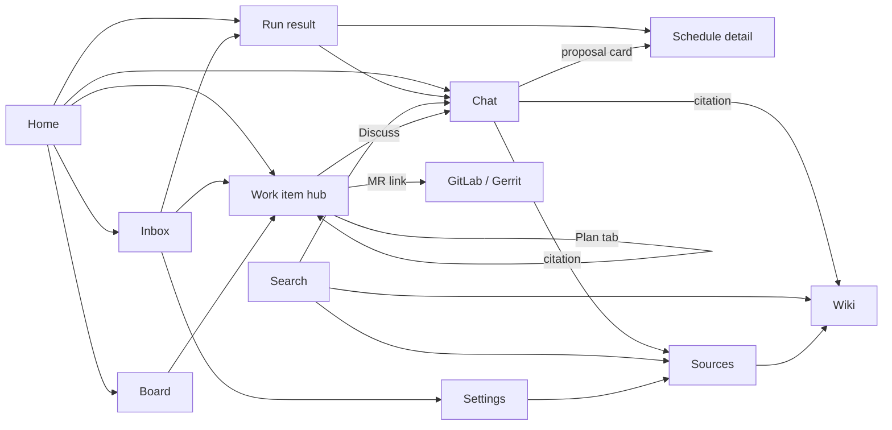

# 07 — User experience: navigation, pages, flows and shared behaviour

Status: approved baseline, 2026-10-21. Applies to every phase. Where page descriptions in 02–04 and this document differ, this document wins for layout, navigation and wording; 02–04 win for data and API behaviour.

This spec answers four questions for every screen: how the user gets there, what they can do, what they see while things happen in the background, and where they go next. Flows in §5 are the acceptance reference for the Playwright tests.

## 1. UX principles

1. **One place for "what needs me".** Anything waiting on the user (a plan to decide, a job to review, an alert, a broken token) appears on Home and in the Inbox, with a link straight to the screen where it's resolved.
2. **Background work never blocks.** Anything that takes more than ~2 seconds (ingest, plan drafting, jobs, scheduled runs) starts, shows as running, and lets the user leave. When it finishes, the user hears about it wherever they are.
3. **Nothing leaves without a look.** Every action that writes outside MyWorkBuddy shows the exact content first (push, MR text, Jira comment). The approve button says what it will do ("Push branch and open merge request").
4. **Always show where text came from.** Answers cite sources. Text from tickets, logs, repos or the agent is labelled ("From Jira", "Written by the agent"), so users know what to trust.
5. **Never lose what the user typed.** Drafts survive navigation, reloads, session expiry and edit conflicts.
6. **Private is the default and always visible.** Every owned item shows a Private or Team badge. Sharing is one deliberate click and says what becomes visible.
7. **Same thing, same look, same word.** One status vocabulary, one set of components, one glossary (§9).

## 2. Users and their main jobs

| User | Main jobs |
|---|---|
| Member (engineer, data scientist) | Ask questions about their own work; keep knowledge current with little effort; get told when something breaks; turn tickets into reviewed merge requests |
| Admin (also a member) | Add and remove people; configure integrations; keep the system healthy; manage budgets |

Typical day for a member: open Home in the morning, read the brief and alerts in Inbox, chat to investigate one, review a job that finished overnight, approve a plan for a new ticket.

## 3. Information architecture

### 3.1 Navigation

Sidebar groups (desktop). Items appear only once their phase ships.

| Group | Item | Route | Phase | Badge |
|---|---|---|---|---|
| — | **Home** | `/` | H | — |
| — | **Inbox** | `/inbox` | 2 | unread count |
| Work | **Chat** | `/chat` | 0 | — |
| Work | **Board** | `/work` | 3 | count of "Needs decision" + "Ready for review" |
| Work | **Jobs** | `/jobs` | 4 | running count |
| Knowledge | **Search** | `/search` | 1 | — |
| Knowledge | **Wiki** | `/wiki` | 1 | dot when the librarian changed pages since last visit |
| Knowledge | **Sources** | `/sources` | 1 (regrouped in H) | dot when an ingest failed |
| Automation | **Schedules** | `/schedules` | 2 | dot when a schedule was paused |
| Footer | **Settings** | `/settings` | 0 | dot when a credential is invalid |
| Footer | **Admin** | `/admin` | 0 | dot when System has a failing check (admins only) |
| Footer | user menu | — | 0 | name, timezone, Sign out |

**Sources** replaces today's separate Projects, Documents and Imports items. It is one page with three tabs: Repositories, Documents, Claude Code sessions. Old routes redirect: `/projects` → `/sources/repos`, `/documents` → `/sources/documents`, `/imports` → `/sources/imports`.

**Top bar** (every page): page title with breadcrumb for nested pages (e.g. `Board / PROJ-123 / Plan`), global search field (`/` to focus; Enter opens `/search?q=`), and the **activity indicator** (§6.3).

**Mobile (< 768 px):** sidebar becomes a bottom tab bar with Home, Inbox, Chat, Search, More. "More" opens the rest of the navigation as a sheet.

### 3.2 Route map

Every object has a stable URL. Links in emails, inbox items, citations and notifications use these.

| Route | Page | Notes |
|---|---|---|
| `/login?next=` | Sign in | Returns to `next` (same-origin path only) |
| `/` | Home | §4.1 |
| `/inbox` | Inbox | |
| `/chat` · `/chat/:sessionId` | Chat | `?context=run:<id>` or `context=plan_revision:<id>` starts a chat with that object attached (§5.7, 03 §9) |
| `/search?q=&scope=&project=` | Search | Filters live in the URL |
| `/wiki` · `/wiki/:pageId` · `/wiki/new?path=` · `/wiki/:pageId/history` · `/wiki/changes` | Wiki | `changes` = librarian review |
| `/sources/repos` · `/sources/repos/:projectId` | Repositories | detail page added in H16 |
| `/sources/documents` · `/sources/imports` | Documents, Claude Code sessions | |
| `/schedules` · `/schedules/new` · `/schedules/:id` · `/schedules/:id/edit` | Schedules | |
| `/runs/:id` | Run result | |
| `/work` | Board | |
| `/work/:id` · `/work/:id/plan` · `/work/:id/job` | Work item hub, tabs Ticket · Plan · Job | |
| `/plans/:id` · `/jobs/:id` | Deep links | Render the hub on the right tab (no redirect, URL kept) |
| `/jobs` | All jobs | |
| `/settings/:tab` | Profile · Integrations · Notifications · Usage · Sessions · Password | |
| `/admin/:tab` | Users · Integrations · System | Admin only; members get 404 |

### 3.3 Navigation map

## 4. Pages

Each page lists layout, primary action, and its states. All pages follow the shared patterns in §6.

### 4.1 Home (`/`)

The landing page after sign-in. Answers "what needs me, what's running, what changed".

| Section | Content | Phase | Empty |
|---|---|---|---|
| Needs you | Cards, newest first: plans in Needs decision; jobs Ready for review; unread alerts; paused schedules; invalid credentials; budget ≥ 80 %; failed ingests. Each card has one primary button that goes where it's resolved ("Review plan", "Review changes", "Open alert", "Update token"). | H (failed ingests, budget), 2 (alerts, paused schedules, invalid credentials), 3, 4 | "Nothing needs you right now." |
| Running now | Background items for this user with progress text and elapsed time (same data as the activity indicator) | H | hidden |
| Today | Phase 2+: the latest morning brief summary if one exists | 2 | hidden |
| Recent | Last 5 chats, last 5 wiki pages changed (by anyone, if visible), "Librarian changed N pages last night" link | H | onboarding checklist (§5.1) |
| Quick actions | New chat, Search, Add repository | H | — |

Data: `GET /api/home` returns all sections in one call (counts and up to 10 items each); refreshed on focus and every 60 s.

### 4.2 Inbox (`/inbox`)

- List grouped by day (Today, Yesterday, date). Each row: severity icon + colour, title, source ("Schedule: K8s health", "Job PROJ-123", "System"), relative time, unread dot.
- Click opens the target (`link`) and marks read. Row menu: Mark unread, Dismiss (undo toast).
- Filters (URL): All · Unread · Alerts. "Mark all read" with undo.
- Empty: "You're all caught up." with a link to Schedules if the user has none ("Create a schedule to get checks delivered here").

### 4.3 Chat (`/chat`, `/chat/:id`)

Layout: session list (left, 280 px, collapsible) · conversation (centre) · context panel (right, collapsible, ≥ 1200 px only; otherwise a "Context" button opens it as a drawer).

- **Session list**: "New chat" button; search box filtering titles; groups Today / This week / Older; "Shared by teammates" section; each row shows title, Team badge if shared, source tag (CC for Claude Code, Run for run transcripts opened from a run).
- **Conversation**: messages; assistant messages show tool activity collapsed ("Searched knowledge for 'deploy timeout' · 8 results"), the answer, citation chips, cost (small, muted, e.g. "$0.03") and a copy button. Streaming shows text as it arrives, a Stop button replaces Send, and a "Thinking…" line until the first token.
- **Composer**: multi-line, Enter sends, Shift+Enter newline, draft saved per session (§6.6). Disabled with a reason when the session belongs to someone else ("Shared by Alex — read-only").
- **Context panel**: project in focus (select), "What the assistant knows about you" (link to `me/how-i-work.md`), attached context (run or plan, removable), session actions (Share with team, Save to memory, Delete).
- **Proposal card** (Phase 2): rendered under the assistant message; §5.6.
- **Errors**: inline under the message per §6.8; the user's message stays and a "Retry" button resends it.
- Session busy (`409 session_busy`, e.g. a second tab): composer shows "A reply is still being written in another tab."

### 4.4 Search (`/search`)

- Query box, scope tabs (All, Wiki, Sessions, Code, Documents), repository filter. All in the URL.
- Results: title, source type icon, Private/Team badge, owner ("you" or name), excerpt with matched terms highlighted, updated time. Click opens the source; code results open the repository detail with path and line range shown.
- "Ask in chat" button: new chat pre-filled with the query and scope.
- Empty query: recent searches (local) and tips ("Use exact identifiers like PROJ-123 or OOMKilled").
- No results: "No matches in your knowledge or your team's shared items." plus "Ask in chat" and "Add sources".

### 4.5 Wiki (`/wiki/...`)

- Left: page tree with "My pages" and "Team wiki" groups, filter box, "New page". Right: page view.
- **Page view**: title, path, badge, last change ("Edited by Librarian, 3 h ago"), actions Edit · History · Share with team / Make private · Delete. Body rendered with the safe Markdown component. Pages written by the librarian show a small banner "Maintained by the librarian; protect your own text with Keep blocks" with a link to help.
- **Editor**: split edit/preview on desktop, tabs on mobile; toolbar with headings, list, code, link, **Keep block**; message field; Save. Unsaved-change guard. On `409 wiki_conflict` the conflict dialog shows the current version and the user's draft side by side with a diff, and actions "Copy my text and reload" or "Discard my edits".
- **History**: commit list (author, time, message); selecting one shows the diff; pre-publish history visible to the owner only, separated by a "Shared with team" marker.
- **Librarian changes** (`/wiki/changes`): last 7 days of librarian commits as expandable diffs, plus rejected updates with the reason ("Not applied: would have removed 3 sections"). Each diff has "Open page" and "Revert this change", which loads the page content at the commit's parent (`GET /api/wiki/pages/{id}/versions/{sha}`, H7) and saves it as a new commit through the normal save path (`base_sha` check included).

### 4.6 Sources (`/sources/...`)

**Repositories** tab: table with name, host, branch, status pill, last ingested (relative), visibility, owner. "Add repository" opens a dialog: integration (Phase 2+; before that GitLab/Gerrit choice), URL, branch (optional), name. The dialog checks that the user has a working token for that host first and links to Settings if not ("You need a GitLab token first — Add token"). After adding, the row appears as Queued → Running with progress text ("Summarising 42 of 150 files"), and a toast confirms "Indexing started; we'll notify you when it's ready".

**Repository detail** (`/sources/repos/:id`): status and last error with a "What to do" hint; last ingested commit; counts (files, code chunks, docs); project card link (wiki); actions Re-index · Share code index with team · Remove. Remove's confirmation lists what's deleted (code index, cache) and what stays (project card, session summaries).

**Documents** tab: drop zone + file picker (PDF, Markdown, text); list with title, chunks, visibility, updated, owner; row actions Replace file, Share/Make private, Delete. Upload shows per-file progress and result.

**Claude Code sessions** tab: instructions with the exact path (`~/.claude/projects/*/*.jsonl`), multi-file drop zone, per-file results (Imported / Unchanged / Failed with reason), link to each imported session in Chat.

### 4.7 Schedules (`/schedules/...`) — Phase 2

- **List**: name, agent, "Weekdays at 08:00" (human cron), next run (local), last result pill, enabled toggle, Run now. Paused schedules show a banner row "Paused after 3 failures — Review".
- **New / Edit**: a single form in four short sections: What (agent picker with descriptions; inputs form generated from the agent's schema), When (presets: Every weekday morning, Every hour, Every day, Custom cron; live preview "Next: Thu 08:00, Fri 08:00, Mon 08:00 (Europe/Stockholm)"; minimum-interval errors inline), Notify (On change · On alert only · Every run; Email toggle), Instructions (optional prompt). "Run once now to test" is available before saving and shows the result in a drawer.
- **Detail**: configuration summary, edit, enable/disable, delete; runs list (status, started, duration, cost, changed?) with "Load more".

### 4.8 Run result (`/runs/:id`)

- Header: schedule name (link), status pill, scheduled time, duration, cost.
- Headline and findings as cards (severity, title, detail, links shown as text with host). "New since last run" tag on findings that weren't in the previous run; "Resolved since last run" section for the reverse.
- Actions: **Investigate in chat** (opens `/chat?context=run:<id>`), Open transcript, Run again, Edit schedule.
- Failed run: error explanation and fix action per §6.8.

### 4.9 Board (`/work`) — Phase 3

- Columns: New · Planning · Needs decision · Approved · In progress · In review · Done (Done shows the last 14 days). Dismissed items are behind a filter.
- Card: Jira key, summary (2 lines), repository (or "Choose repository" warning), Jira status, cost so far, one primary action matching the state (Draft plan / Review plan / Start job / Review changes / Open MR).
- "Add ticket" (by key) and "Refresh from Jira". Mobile: columns become a segmented list with the column name as a filter.

### 4.10 Work item hub (`/work/:id`, tabs) — Phases 3–4

Header (all tabs): Jira key (links to Jira), summary, repository@branch, a **progress strip** Ticket → Plan → Approved → Job → Review → Merged showing the current step, and the one next action.

- **Ticket tab**: Jira fields labelled "From Jira", repository selector, Dismiss.
- **Plan tab**: revision selector ("Revision 3 of 3 · by planner · 10 min ago"), validation panel at the top (errors in red with links to the field; warnings with checkboxes to acknowledge), then sections in reading order: Summary, Questions and assumptions, Approach and alternatives, File changes (table with action icons; paths that don't exist highlighted), Tests, Verification commands (monospace, "Runs in the sandbox"), Risks, Rollback, Sandbox request, Commit message. Footer bar (sticky): **Revise with feedback** (textarea + send), **Edit**, **Discuss in chat**, **Reject**, **Approve revision 3** (disabled with a tooltip listing what's missing). Compare revisions opens a field-level diff.
- **Job tab**: timeline of job events with live updates; current step with elapsed time and attempts ("Attempt 2 of 3"); Cancel. When ready for review: files changed with a side-by-side diff (unified on mobile), checks list (pass/warn/fail with explanation), verification logs (collapsed, tail shown), agent notes labelled "Written by the agent", cost. Actions: **Request changes** (feedback box), **Discard**, **Review push**. After push: MR/change link, Jira comment link, "Watching for merge".
- **Push preview** (dialog or full-screen on mobile): target repo and branch, commit message, MR title and description, Jira comment toggle and text, acknowledgements (e.g. "Push despite failing checks"). All text fields editable. Button: "Push branch and open merge request" (GitLab) / "Upload change to Gerrit". After click: progress inline, then success with links.

### 4.11 Jobs (`/jobs`) — Phase 4

Table of the user's jobs: ticket, status pill, attempt, started, duration, cost; filter by status. Rows open the work item hub on the Job tab.

### 4.12 Settings (`/settings/:tab`)

| Tab | Content |
|---|---|
| Profile | Display name, email, timezone (searchable list, defaults to browser zone on first visit with a confirm), theme (System / Light / Dark, stored in the browser) |
| Integrations | One card per integration: credential fields (write-only; shows "Set · verified 2 days ago" or "Invalid: 401 from Jira" in red), Test, Remove. Help text per kind (where to create the token, required scopes). Phase H: GitLab/Gerrit/Jira tokens as today |
| Notifications | Email on/off; daily email cap info; Jira intake (Phase 3) settings |
| Usage | This month's AI spend vs budget (bar), top uses (chat, schedules, jobs) |
| Sessions | Active sign-ins (device, IP, last seen) with "Sign out other sessions" |
| Password | Change password (signs out everywhere, explained before submit) |

### 4.13 Admin (`/admin/:tab`)

- **Users**: table (name, role, active, last login, spend this month, budget); Add user dialog (generates a one-time initial password shown once with copy button and "ask them to change it"); row actions Edit, Reset password, Disable, Delete (offboarding dialog with preview counts and "Transfer team items to" picker; type the username to confirm).
- **Integrations** (Phase 2): list and edit dialogs; Kubernetes allowed kinds/namespaces; feed allowlist; CA bundle upload.
- **System**: checks (green/red) from `/api/ready`; queues (waiting, running, failed 24 h, Retry); last runs of periodic tasks; backup status and last restore drill; disk; reconcile status; stuck embeddings; spend this month.

### 4.14 Sign in (`/login`)

Username, password, Sign in. Errors: wrong credentials (generic), rate limited ("Too many attempts. Try again in 15 minutes."). After sign-in go to `next` or Home. A banner explains "Your session expired" when redirected with `reason=expired`.

## 5. Cross-page flows

Each flow lists the steps a user takes, what the system shows, and where it ends. These are implemented as Playwright tests (fake LLM) where marked **E2E**.

### 5.1 First run

**Admin (once).** Sign in with the CLI-created account → Home shows an **Admin setup checklist**: 1. Check System is green, 2. Add integrations (Phase 2), 3. Add users, 4. Set budgets. Each item links to the right tab and ticks itself when done. The checklist hides when complete or dismissed.

**Member (first sign-in).** Home shows a **Getting started checklist** instead of the empty Recent section:

| Step | Link | Done when |
|---|---|---|
| Confirm your timezone | Settings → Profile | timezone saved |
| Add your GitLab / Gerrit / Jira tokens | Settings → Integrations | at least one credential verified |
| Add a repository | Sources → Add repository | one repository Ready |
| Import Claude Code sessions (optional) | Sources → Claude Code sessions | one import |
| Ask your first question | Chat | one chat message |

Each page reached from the checklist shows a "Back to getting started" link in the top bar until the step is done. **E2E**: new user completes steps with stubbed integrations; checklist ticks and disappears.

### 5.2 Ask about my work (chat with knowledge) — **E2E**

1. Home → New chat (or `c`). Chat opens a new session with the composer focused.
2. User asks. Assistant streams; tool activity line shows the search; answer has citation chips [1] [2].
3. User clicks [1] → the wiki page / document / repository detail opens **in the context panel drawer** (desktop) so the conversation stays visible; "Open full page" navigates. On mobile it navigates, and Back returns to the same scroll position in the chat.
4. Optional: user selects a project in focus; the next answer uses its project card.
5. Leaving the page keeps the unsent draft; returning restores it.

### 5.3 Add knowledge and find it — **E2E**

1. Sources → Repositories → Add repository. If no token: inline prompt "Add a GitLab token first" → Settings → Integrations (opened with that integration highlighted) → save and Test → "Back to Add repository" returns with the dialog re-opened and fields kept.
2. Repository appears as Queued → Running ("Cloning…", "Summarising 42/150 files", "Indexing"). User can leave; the activity indicator shows it.
3. When ready: toast if the user is in the app ("payments-api is ready · Open"), Home "Recent" updates, and the project card appears in Wiki. If it fails: red pill, Home "Needs you" card "Indexing payments-api failed — Retry", detail page shows the reason and a fix hint (e.g. "Token rejected by GitLab — Update token").
4. Search finds code by function name and README text.

### 5.4 Share and unshare — **E2E**

1. On any owned item (document, wiki page, repository code index, chat session), "Share with team" opens a short confirmation that states what becomes visible: e.g. for a repository "Your code index and repo docs for payments-api become searchable by everyone. Your project card stays private unless you share it separately." Confirm.
2. Badge changes to Team instantly; a toast offers Undo for 10 s.
3. Teammate B: the item appears in B's search and lists with owner shown. B cannot edit it unless admin.
4. Admin can "Remove from team space" on any shared item; from Phase 2 the owner also gets an inbox item "Admin made 'X' private".

### 5.5 Wiki edit, librarian and conflicts — **E2E**

1. User edits a page and saves → toast "Saved"; History shows the commit.
2. Overnight the librarian updates pages. Next morning Wiki shows a dot; Home "Recent" says "Librarian changed 3 pages last night — Review".
3. `/wiki/changes`: user expands a diff, disagrees, clicks "Revert this change" → confirmation → new commit. Rejected updates show their reason.
4. Conflict: page open in two tabs; save in tab A succeeds; save in tab B shows the conflict dialog with both versions; "Copy my text and reload" copies the draft to the clipboard and loads the current version with a note "Your text is on the clipboard".

### 5.6 Create a schedule from chat — **E2E** (Phase 2)

1. In chat: "Check the payments namespace every weekday morning and tell me only if something's wrong."
2. Assistant replies and shows a **proposal card**: "K8s health · payments · Weekdays at 08:00 (Europe/Stockholm) · Notify on alert only · Next: Thu 08:00". Buttons **Create**, **Edit**, **Dismiss**.
3. Create → card turns into "Schedule created · Open" and a toast confirms. Edit → schedule form pre-filled in a drawer; Save creates it and updates the card.
4. User opens the schedule → "Run once now to test" → drawer shows the run result within the page.
5. Next morning: if nothing's wrong, nothing arrives (on-alert mode); the Schedules list shows the last result as OK.

### 5.7 Get an alert and investigate — **E2E** (Phase 2)

1. A run finds a crashlooping pod → inbox item (alert) + email "MyWorkBuddy alert: payments — 1 pod crashlooping" with one link.
2. User clicks the email link → if signed out, login with `next=/runs/<id>` → Run result.
3. Finding shows "New since last run". User clicks **Investigate in chat** → new chat with the run attached as context (shown as a chip in the context panel); the first suggested prompt is "What's the likely cause and what should I check?".
4. User fixes the issue outside. Next run: "Recovered" inbox item (info) "payments: all findings resolved".
5. If runs fail 3 times: inbox + email "Schedule 'K8s health' paused"; Home card "Review paused schedule" → schedule detail shows the last error and a "Resume" button that's enabled once the cause (e.g. invalid kubeconfig) is fixed or acknowledged.

### 5.8 Ticket to approved plan — **E2E** (Phase 3)

1. Board → card PROJ-123 (New) → **Draft plan**. If no repository is set, the button first asks for one (inline select).
2. Card moves to Planning with "Planner is working… usually 1–3 min". User can leave. Activity indicator shows it.
3. Done → inbox "Plan ready for PROJ-123", Board badge, Home "Needs you". Click → hub, Plan tab.
4. User reads; answers a question in "Questions and assumptions" by typing feedback → **Revise with feedback** → revision 2 drafting (same background pattern) → arrives with "Changed from revision 1" highlights.
5. Warnings to acknowledge (e.g. "Changes CI configuration") → tick → **Approve revision 2** → progress strip moves to Approved; next action "Start job" (Phase 4) appears.
6. Reject → confirmation with optional reason → card back to New.

### 5.9 Approved plan to merge request — **E2E** (Phase 4; fake LLM, local Git server)

1. Hub → **Start job** → confirmation summarising limits ("Up to 45 min, 3 attempts, budget $10, network: package mirrors only"). Job tab opens with the live timeline.
2. User can leave. Activity indicator shows "PROJ-123 job · Attempt 1 · 12 min".
3. Ready → inbox + email "Changes ready for review: PROJ-123". Hub Job tab shows diff, checks, logs.
4. **Request changes** with feedback → new round; timeline continues. Or **Review push** → preview with editable MR text and Jira comment → **Push branch and open merge request**.
5. Success → links to MR and Jira comment; Board card moves to In review. When the MR merges, inbox "PROJ-123 merged" and the card moves to Done.
6. Failure paths: checks failed at max attempts → review screen shows failed checks; push requires ticking "Push despite failing checks". Timeout/budget → Job tab explains and offers "Start a new job" (with a higher limit only if the admin allows).

### 5.10 Fixing problems where they're reported

Every error that needs user action shows the **same message and the same fix button** wherever it appears (inline, Home card, inbox item):

| Problem | Message | Fix button → destination |
|---|---|---|
| Credential invalid | "Your Jira token was rejected (401). Jobs and schedules that need Jira will fail until you update it." | Update token → Settings → Integrations, Jira card focused |
| Budget ≥ 80 % / exceeded | "You've used 85 % of this month's AI budget ($50)." / "…reached… An admin can raise it." | View usage → Settings → Usage |
| Ingest failed | "Indexing payments-api failed: <reason>" | Retry (inline) / Open repository |
| Schedule paused | "Paused after 3 failures: <last error>" | Review → Schedule detail |
| Job failed | "Job stopped at <stage>: <reason>" | Open job → hub Job tab |
| LLM unavailable | "The AI service isn't responding. Your message is saved; try again in a minute." | Retry |

After the fix, the originating screen offers "Retry" and the Home card disappears automatically.

### 5.11 Session expiry mid-work

Any 401 from the API: the current draft (chat composer, wiki editor, plan feedback, schedule form) is already in local storage (§6.6); the app navigates to `/login?next=<current path>&reason=expired`; after sign-in the user lands on the same page with the draft restored and a toast "Restored your unsaved text".

### 5.12 Admin: add and remove a user — **E2E**

Add: Admin → Users → Add user → one-time password shown once → user signs in and is forced to change it (`must_change_password` flag, H11) → Getting started checklist.

Remove: Delete → offboarding dialog shows counts ("12 private items will be deleted; 3 team items will be transferred to you") → type the username → done; audit entry visible in System.

## 6. Shared behaviour

### 6.1 Status vocabulary

All entity statuses map to six visual states. One `StatusPill` component takes the raw status and a mapping table; text is always shown next to the colour and icon (never colour alone).

| Visual state | Colour / icon | Raw statuses |
|---|---|---|
| Waiting | grey · clock | project `queued`, run `queued`, job `created` |
| Working | blue · animated spinner | project `running`, run `running`, plan `drafting`, job `preparing`/`running`/`verifying`/`pushing` |
| Needs you | amber · hand | plan `needs_decision`, job `awaiting_review`, schedule paused, credential invalid |
| Done | green · check | project `ready`, run `succeeded` (status ok), plan `approved`, job `pushed`/`merged` |
| Problem | red · alert | `failed`, `timed_out`, `budget_exceeded`, run status alert |
| Off | grey outline · minus | disabled schedule, `cancelled`, `discarded`, `dismissed`, `closed`, `skipped` |

Run results with status `warning` use amber "Warning" (a sub-state of Needs you in colour only).

### 6.2 Visibility

- `VisibilityBadge`: "Private" (lock icon) or "Team" (people icon), always next to the title of owned items.
- `VisibilityControl`: "Share with team" / "Make private" with the confirmation text from §5.4 per item type; admins see "Remove from team space" on others' items.
- Lists that mix owners show "you" or the owner's display name.

### 6.3 Background work and the activity indicator

- Starting background work returns immediately; the triggering control shows the Working state; a toast says what started and that the user can leave.
- **Activity indicator** in the top bar: spinner + count when the user has running items; click opens a popover listing each (name, step text, elapsed) linking to its page. Data: `GET /api/activity` (ingests, plan drafts, jobs, manual runs), polled every 5 s while the popover is open or a Working item is visible, otherwise every 30 s.
- On completion while the user is in the app: toast with "Open"; alerts and "Needs you" items also get an inbox item. Work finishing while the user is away: inbox (+ email for jobs ready, plans ready only if enabled, alerts).

### 6.4 Live updates per screen

| Screen | Mechanism |
|---|---|
| Chat reply | SSE (existing) |
| Job tab timeline | SSE `GET /api/jobs/{id}/events` with replay from last seq on reconnect |
| Lists with Working items (repositories, board, schedules, runs) | Poll 3 s while any visible item is Working; stop otherwise |
| Inbox badge, Home, activity | Poll 30 s / 60 s / per §6.3 |
| All polling | Paused when the tab is hidden (`visibilitychange`); refetch on focus |

### 6.5 Feedback: toasts, inline, inbox

| Use | When |
|---|---|
| Inline message | Validation and errors tied to a field or a control; results of an action on the same screen |
| Toast (bottom-right, 5 s, max 3 stacked, with optional Undo/Open) | Confirmation of a completed action; background completion while in-app |
| Inbox item | Anything the user must see later or act on; background results; system notices |
| Banner (top of page) | Page-level state: read-only shared item, paused schedule, budget exceeded, session expired |
| Dialog | Confirmation of destructive or outbound actions; conflicts |

### 6.6 Forms and drafts

- Validation on blur and submit; server `422` errors mapped to fields by `errors[].loc`; the first invalid field is focused.
- Unsaved-change guard on the wiki editor, schedule form, plan editor and push preview (React Router blocker + `beforeunload`).
- Drafts in `localStorage` (key `draft:<user>:<screen>:<id>`, wrapped in try/catch, cleared on successful submit): chat composer per session, wiki editor per page, plan feedback per plan, schedule form.
- Buttons show a pending state and stay disabled until the request finishes; double-submit is impossible.

### 6.7 Destructive and outbound actions

- Confirmation dialog names the object and lists consequences ("Deletes the session and its summary. This can't be undone.").
- Type-to-confirm only for deleting users and removing repositories with a shared index.
- Undo toast instead of a dialog for cheap, reversible actions (dismiss inbox item, mark read, share/unshare within 10 s).
- Outbound actions (approve plan, approve push) use explicit verbs and show what will be sent; never a generic "OK".

### 6.8 Errors

The UI maps every API error `code` (01 §H5) to a message and, where possible, an action (table in §5.10 plus): `not_found` → "This item doesn't exist or isn't shared with you." with a link Home; `forbidden` → "Only the owner can do this."; `conflict` → refresh hint; `rate_limited` → wait time; `validation_error` → field messages; anything else → "Something went wrong. It's been logged (ref <request id>)." with a Copy button. Raw stack traces or server messages are never shown.

### 6.9 Loading and empty states

- Lists and pages show skeletons after 300 ms; nothing for faster responses.
- Any wait over 10 s shows text explaining what's happening ("Still working — large repositories take a few minutes").
- Every list has an empty state with one sentence and one primary action (defined per page in §4).

### 6.10 Time, numbers, money

- Relative times ("5 min ago") with the absolute local time on hover/long-press, in the user's timezone. If the browser timezone differs from the profile, schedule screens show the zone name explicitly.
- Cron is never shown raw unless the user chose Custom; then both raw and the description are shown.
- Money: USD with two decimals (four below $0.01, e.g. "$0.0042").

### 6.11 Keyboard

`/` focus search · `c` new chat · `g` then `h`/`i`/`w`/`b` go Home/Inbox/Wiki/Board · `Esc` close dialog/drawer · `Enter` send / `Shift+Enter` new line · `Ctrl/Cmd+Enter` submit forms · `?` shortcut help. Shortcuts are disabled while typing in a field (except Esc and the submit keys).

## 7. Accessibility and responsive rules

**Target: WCAG 2.2 AA.**

- Contrast ≥ 4.5:1 text, 3:1 UI components, in both themes (checked in CI via axe and the token contrast test).
- Every control reachable and operable by keyboard; visible focus ring (2 px accent outline); logical tab order; dialogs trap focus and return it on close.
- Status never by colour alone (icon + text, §6.1).
- Streaming chat: the message container is `aria-live="polite"` but only announces "Answer ready" on completion, not each token.
- Forms: labels for every input; errors linked with `aria-describedby`.
- `prefers-reduced-motion` disables spinners' rotation (static icon) and transitions.
- Touch targets ≥ 44 × 44 px on mobile.

**Breakpoints.**

| Width | Layout |
|---|---|
| ≥ 1200 px | Sidebar expanded; list/detail split views; chat context panel inline |
| 768–1199 px | Sidebar collapsed to icons with tooltips; context panels as drawers |
| < 768 px | Bottom tab bar; list → detail as stacked pages with Back; diffs unified; dialogs full-screen |

Everything works on mobile, including approvals. The push preview and diff are readable on mobile but show a hint "Easier to review on a larger screen".

## 8. Design system

Build on the existing CSS variables in `frontend/src/styles.css` (colours, fonts, light/dark). Add:

| Token group | Values |
|---|---|
| Spacing | 4, 8, 12, 16, 24, 32, 48 px (`--s-1` … `--s-7`) |
| Radius | 4 (inputs), 8 (cards, dialogs), 999 (pills) |
| Type scale | 12, 13, 14 (body), 16, 18, 24, 30 |
| Elevation | `--shadow-1` (cards), `--shadow-2` (popovers), `--shadow-3` (dialogs) |
| Status colours | waiting, working, needs-you, done, problem, off — each with fg and soft bg, both themes |
| Z-index | content 0, sticky 10, drawer 40, dialog 50, toast 60 |
| Theme | `data-theme="light|dark"` on `<html>` overrides `prefers-color-scheme` (Settings → Profile) |

**Components** (`frontend/src/components/`), each with documented states (default, hover, focus, disabled, loading, error) and shown in a dev-only gallery route `/dev/components`:

Button (primary, secondary, danger, ghost; with pending state) · IconButton · TextField · TextArea · Select · Checkbox · Toggle · RadioGroup · Dialog · Drawer · Popover · Menu · Tabs · Tooltip · Toast · Banner · Card · Table (sortable header, empty and loading rows, "Load more") · List · StatusPill · VisibilityBadge · VisibilityControl · CountBadge · Skeleton · EmptyState · ErrorNote · Markdown (safe, H4) · CodeBlock · DiffView (split/unified) · Timeline · CronPreview · KeyValue · ProgressStrip · ActivityIndicator · ProposalCard · CitationChip.

**What H15 built, and what comes later.** H15 ships Button, IconButton, FileButton, TextField, TextArea, Select, Checkbox, Toggle, RadioGroup, Dialog, ConfirmDialog, Drawer, Popover, Menu, Tabs and LinkTabs (route tabs), Tooltip, Toast, Banner, Card, DataTable, StatusPill, VisibilityBadge, VisibilityControl, CountBadge, Dot, Skeleton, EmptyState, ErrorNote, Markdown, CodeBlock, DiffView (unified only), KeyValue. ActivityIndicator and CitationChip arrive with H16 (they need `/api/activity` and the chat context drawer); Timeline, CronPreview, ProgressStrip and ProposalCard arrive with the Phase 2–4 screens that use them. Lists stay plain `<ul>`s with the `list-item` class until a page needs more.

**What H16 built, and what it left for later.** Home with Needs you, Running now, Recent, Quick actions and both checklists; the activity indicator with completion toasts; Settings tabs (Profile, Integrations, Usage, Sessions, Password); repository detail with fix hints; `/wiki/changes` with "Revert this change"; citation drawer; share confirmations with Undo; error-code messages; drafts and session-expiry restore; unsaved-change guard on the wiki editor; relative times in the user's timezone; delayed skeletons and long-wait text. Decisions made while building it:

- Checklist "tokens" ticks when a credential is **verified** (S1 added the Test button). The admin checklist's integrations step and the Notifications tab still come later in Phase 2.
- "Revert this change" refuses (409) when a page changed after the librarian's edit, so it never drops newer work; those are fixed by hand.
- The Wiki dot and dismissed checklists are remembered per browser (localStorage), not per account.
- Usage lists chat spend only; schedules and jobs join it in their phases.
- Drafts are kept for the chat composer (per session), the wiki editor (per page, with the version it was opened on) and the Add repository form.
- Not yet: restoring the chat scroll position after a citation opened on a phone (07 §5.2 step 3), and plan/schedule drafts (their screens don't exist yet).
- End-to-end, flow 5.1 checks that steps tick and the checklist can be dismissed; "disappears when complete" is a vitest test, because CI has no git server to make a repository Ready. Librarian revert is covered by API and vitest tests; the E2E for 5.5 covers save, history and the two-tab conflict.

**Gallery in production.** `/dev/components` renders for everyone in dev builds and for **admins** in production builds. The visual baselines and axe checks then run against the production bundle CI deploys, not a dev server. Members are redirected to Chat.

**Library choice.** Radix UI primitives (`@radix-ui/react-*`) for Dialog, Popover, Tabs, Tooltip, DropdownMenu, Toast, Checkbox, Switch — they solve focus management and ARIA correctly — styled with our CSS variables (no Tailwind). Icons: `lucide-react`. Both are small and tree-shaken. This replaces the earlier "shadcn/ui" note in the original plan.

**Frontend conventions.**

- API types generated from the backend OpenAPI schema with `openapi-typescript` into `src/api-schema.ts` (`npm run api:types`, which runs `backend/scripts/openapi.py`; not `src/api/schema.ts`, which would sit beside the existing `api.ts` module). CI fails if the generated file is stale (`npm run api:check`). `api.ts` re-exports the schema types under the old names. The exceptions are JSON the backend returns as free-form dicts (chat citations and tool calls, `/api/admin/system`), which keep hand-written types next to their use. API models use `Literal` for every enum (rule R9), checked by `backend/tests/test_api_enums.py`.
- Feature folders: `src/features/<area>/` (pages, hooks, components local to the area); shared components in `src/components/`.
- TanStack Query keys: `[area, resource, id?, params?]`; mutations invalidate by area prefix.
- Route-level code splitting (`React.lazy`) per feature; initial JS ≤ 250 KB gzipped (checked in CI by `npm run size`, `scripts/bundle-size.mjs`: the entry script plus everything `index.html` preloads).
- One SSE helper (existing `streamPost`, plus a GET variant with reconnect and `Last-Event-ID`).

## 9. Wording and glossary

Voice: short, plain, active; say what happened and what to do next; no blame; no exclamation marks.

| Internal term | UI term |
|---|---|
| project | Repository |
| document (upload) | Document |
| episode | Session summary |
| visibility public / private | Team / Private |
| publish / unpublish | Share with team / Make private |
| work item | Ticket (shown as "PROJ-123 · repo") |
| plan revision | Revision |
| job | Job |
| run | Run |
| schedule | Schedule |
| agent | Check type (in the schedule form); agent name elsewhere |
| librarian | Librarian |
| approval | Approve / Approve revision N / Push branch… |
| budget_exceeded | "AI budget reached" |

## 10. UX acceptance and testing

1. **Flows**: each flow in §5 marked E2E has a Playwright test with the fake LLM (and stub integrations / local git server for Phases 2–4).
2. **Accessibility**: `@axe-core/playwright` runs on every page visited by the E2E suite, light and dark; zero serious/critical violations.
3. **Visual**: Playwright screenshots of `/dev/components` and of Home, Chat, Plan tab and Job review in both themes at 1280 and 390 px; diffs reviewed in PRs. Baselines live in `frontend/e2e/ux.spec.ts-snapshots/` and are rendered by CI's Chromium, never locally (fonts and rasterisation differ). When a baseline is missing, CI writes it, commits it to the PR branch ("Add visual baselines rendered by CI") and fails that run; review the images in the PR, and the next push compares against them. For PRs from forks it uploads the `visual-baselines` artifact instead. To change one on purpose, delete the file in the PR and let CI write the new one. Comparisons allow 2 % of pixels to differ and mask the signed-in user's name. H15 covers the gallery and the sign-in page. Chat and Home get baselines in H16, once the E2E suite seeds deterministic data for them; the others come with their phases.
4. **Usability check** (*manual*, per phase release gate): two teammates who didn't build the feature do five tasks from §5 without help; anything that needs explanation becomes a bug or a copy change before release.
